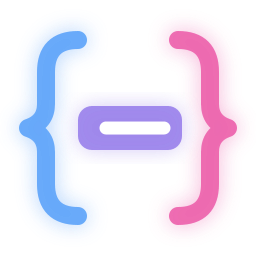
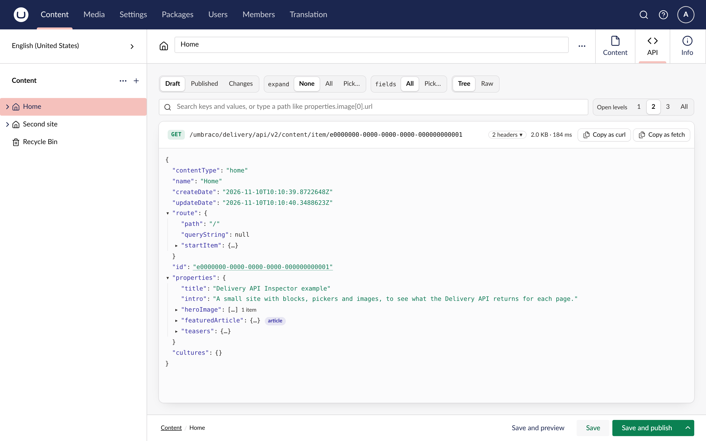

<p align="center">
  
</p>

<h1 align="center">Delivery API Inspector for Umbraco</h1>

<p align="center">
  An API tab on every document and media item in the Umbraco backoffice,<br />
  with the JSON the Delivery API returns for it.
</p>

[](https://www.nuget.org/packages/TheBuilder.DeliveryApiInspector)
[](https://marketplace.umbraco.com/package/thebuilder.deliveryapiinspector)
[](https://github.com/thebuilder/umbraco-delivery-api-inspector/blob/main/LICENSE)



The tab builds the response with the Delivery API's own builders, so it shows the JSON a frontend
receives. You don't need an API client or the site's API key.

Draft is the default view. Published shows what frontends get today, and Changes shows what
publishing the draft would change.

The response is a tree you can search and filter, open to a set depth, and request with `expand` and
`fields` from a menu. Blocks and pickers show their content type, media URLs show a thumbnail on
hover, and a GUID opens its document or media item. The request copies as a URL, a curl command or a
`fetch` call, and the response, or any part of it, copies as JSON.

The package is a preview. It supports Umbraco 17.4 and later, Umbraco 18 included, on .NET 10.

## Getting started

1. Install the package in your Umbraco site:

   ```sh
   dotnet add package TheBuilder.DeliveryApiInspector --prerelease
   ```

2. Make sure `Program.cs` calls `AddDeliveryApi()`. The public Delivery API does not have to be
   enabled.

3. Sign in as an administrator, open a document, and click **API**.

Administrators see the tab. To give it to another group, turn on **View Delivery API output** in the
group's permissions under **Users**, **User groups**. It can be set for part of the content tree too.

The [documentation](https://delivery-api-inspector.thebuilder.dk/) covers every view, the request
bar, access and configuration.

## Development

See [AGENTS.md](AGENTS.md) for the layout and commands, and [samples/README.md](samples/README.md)
for the sample site and the end-to-end check.

## License

[MIT](LICENSE)
