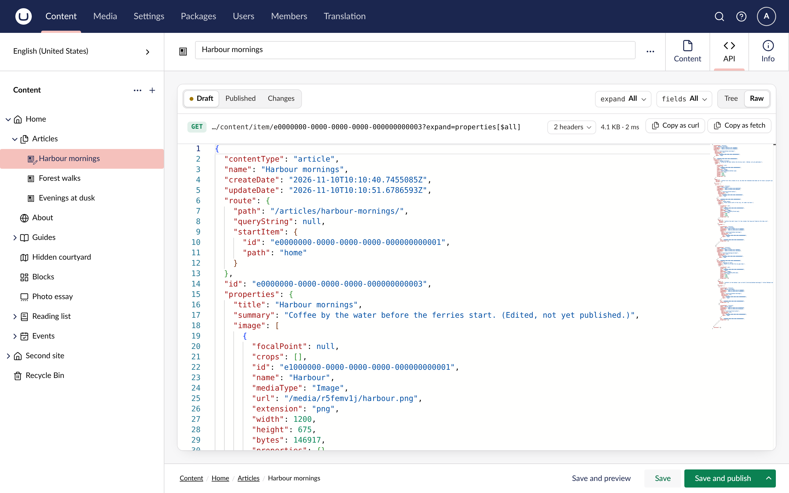

The API tab shows the response as a tree. Objects and arrays collapse to one line, with a count of what is inside and, for a block or a picked item, its content type.

## Open levels

The **Open levels** control opens the tree to a depth: 1 shows the top-level keys, 2 and 3 open the next levels, and All opens everything. The choice is remembered for the next item you open.

To open or close a single branch with everything under it, Alt-click its row.

## Search

Type in the search field to filter the tree to the keys and values that match. Matches are highlighted, and the branches around them stay open so you can see where each one is. Press Enter for the next match and Shift+Enter for the previous one.

Type a path instead, such as `properties.heroImage[0].url`, and the tree jumps to that value. Every row has a **Copy path** action that copies its path in the same form, and a **Copy value** action.

## expand and fields

The Delivery API returns pickers and blocks shallow unless the request asks for more. The `expand` and `fields` dropdowns at the top of the panel set those request parameters for you:

- **expand**: None returns linked items as references, All expands every property one level, and Pick… lets you choose which properties to expand.
- **fields**: All returns every property, and Pick… returns only the properties you choose.

The pickers list the properties of the response you are looking at, so you never type an alias. A request that the API refuses shows the API's own error.

## Tree and Raw

**Tree** is the default. **Raw** shows the same response as formatted JSON in Umbraco's code editor, for copying a block of it or using the editor's own search.

## Umbraco-aware rows

- A collapsed block or picked item shows its `contentType`, and a media item its `mediaType`.
- Hovering a row with a media URL shows a thumbnail of the image.
- A GUID that names a document or media item is a link that opens it in the backoffice, in a new tab.

