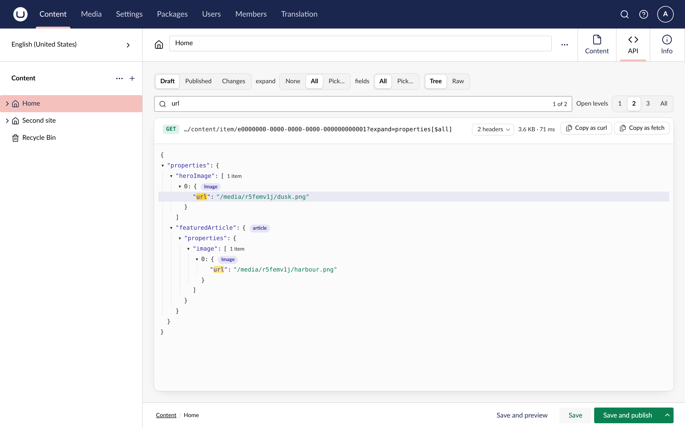
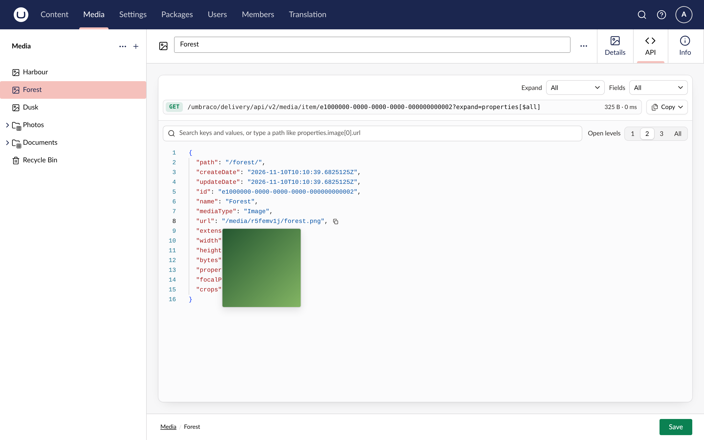

The API tab shows the response as a tree. Objects and arrays collapse to one line, with a count of what is inside and, for a block or a picked item, its content type.

## Open levels

The **Open levels** control opens the tree to a depth: 1 shows the top-level keys, 2 and 3 open the next levels, and All opens everything. A response opens fully by default, or 2 levels deep when it is over 1,000 lines or 200 KB. Once you pick a depth, it is remembered for the next item you open.

Click a branch's arrow, key or brackets to open or close it. <kbd>Alt</kbd>-click opens or closes it with everything under it. From the keyboard, <kbd>→</kbd> and <kbd>←</kbd> open and close the focused branch.

## Search

Type in the search field to filter the tree to the keys and values that match. Matches are highlighted, and the branches around them stay open so you can see where each one is. Press <kbd>Enter</kbd> for the next match and <kbd>Shift</kbd>+<kbd>Enter</kbd> for the previous one.

Type part of a path, such as `properties.hero` or `heroImage[0].url`, to filter to the rows on that path. A matched object or array opens one level, so you can see what is in it.

## expand and fields

The Delivery API returns pickers and blocks shallow unless the request asks for more. The **Expand** and **Fields** dropdowns at the top of the panel set those request parameters for you:

- **Expand**: None returns linked items as references, All expands every property one level, or tick the properties to expand.
- **Fields**: All returns every property, or tick the properties you want back.

Each dropdown lists the properties of the response you are looking at, so you never type an alias. Ticking a property clears All, and choosing All clears the ticks. A request that the API refuses shows the API's own error.

## Layout and copying

The tree looks like the response in a code editor: line numbers from the formatted JSON, two-space indents with guides, and coloured bracket pairs that light up together when you point at either one. **Copy response** in the Copy menu copies the whole response as formatted JSON. To copy one part, hover its line and click the copy icon after it: an object or array comes as formatted JSON, a value as plain text.

## Content types, media and links

- A collapsed block or picked item shows its `contentType`, and a media item its `mediaType`. For users with access to the Settings section, the label is a link that opens the document or media type in a new tab.
- Hovering a row with a media URL shows a thumbnail of the image.
- A GUID that names a document or media item is a link that opens it in the backoffice, in a new tab.

