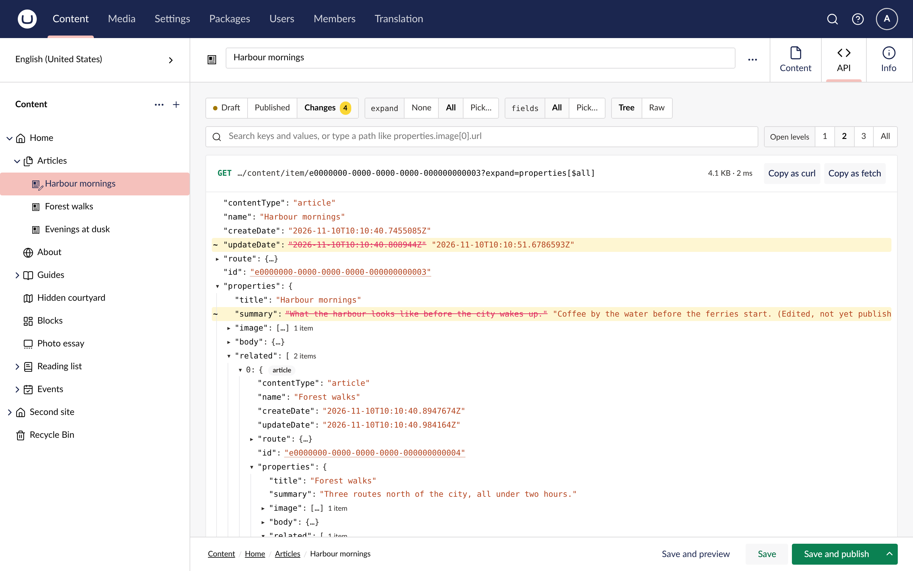

A document has up to two versions in the Delivery API: the draft, which `Preview: true` returns, and the published version, which every other request gets. The switch above the tree picks which one you see.

- **Draft** is the default, because it is the version you are editing. A dot on it means the draft has changes that are not published yet.
- **Published** is what frontends get today. It is disabled for a document that has never been published.
- **Changes** compares the two and shows what publishing the draft would change, with a count.

## Changes

The Changes view shows the draft's tree with every difference marked: added values, removed values with a strike-through, and changed values next to what they were. Branches that contain a change open by themselves, so you see every change without opening the tree by hand.

Save a change and the tab reloads by itself. So does a publish.

## Media

Media items have no draft, so the media tab has no version switch.

## Cultures and segments

On a document that varies by culture, the tab shows the culture you are editing, and sends it as `Accept-Language`. The same goes for a segment, sent as `Accept-Segment`.
