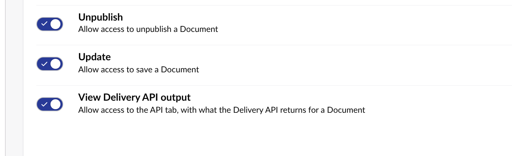

The API tab is for developers. A user sees it when one of their user groups has the **View Delivery API output** permission. The package gives it to Administrators once, when it is installed or upgraded, so out of the box only administrators see the tab. Take it off Administrators and it stays off.

## Give a group the tab

<Steps>
<Step title="Open the user group">

In the backoffice, go to **Users**, then **User groups**, and open the group.

</Step>
<Step title="Tick the permission">

Under **Default permissions** for documents, turn on **View Delivery API output**, and save. Members see the tab the next time they load the backoffice.

</Step>
</Steps>

Like Umbraco's own document permissions, it can also be set for part of the content tree, under **Permissions** on the same group. There it opens or closes the tab for a document and everything below it, and the closest setting on a document's path wins.

Media items have no permissions of their own in Umbraco, so the tab on media follows a group's default document permission.

## Groups named in settings

To keep access in code instead, name the groups in [`UserGroups`](/configuration). Members of those groups see the tab on every item, whatever their permissions.

## What a user can see

A user with the tab sees an item's output only when they could browse the item anyway: the document needs the Browse permission for that user, and the item has to be inside the user's start nodes. Otherwise the tab answers that the item does not exist, or that they cannot browse it.

The content type labels in the tree link to the document or media type only for users with access to the Settings section. Everyone else sees the same labels as plain text.

The package's API is at `/umbraco/delivery-api-inspector/api`, behind the backoffice's own sign-in, and is left out of the Management API's OpenAPI document. It builds the response on the server, so the browser never needs the Delivery API key, and the key is never sent to it.

## Production

The tab only reads, so it is safe on a production site. To turn it off there, set `DeliveryApiInspector:Enabled` to `false` for that environment.
