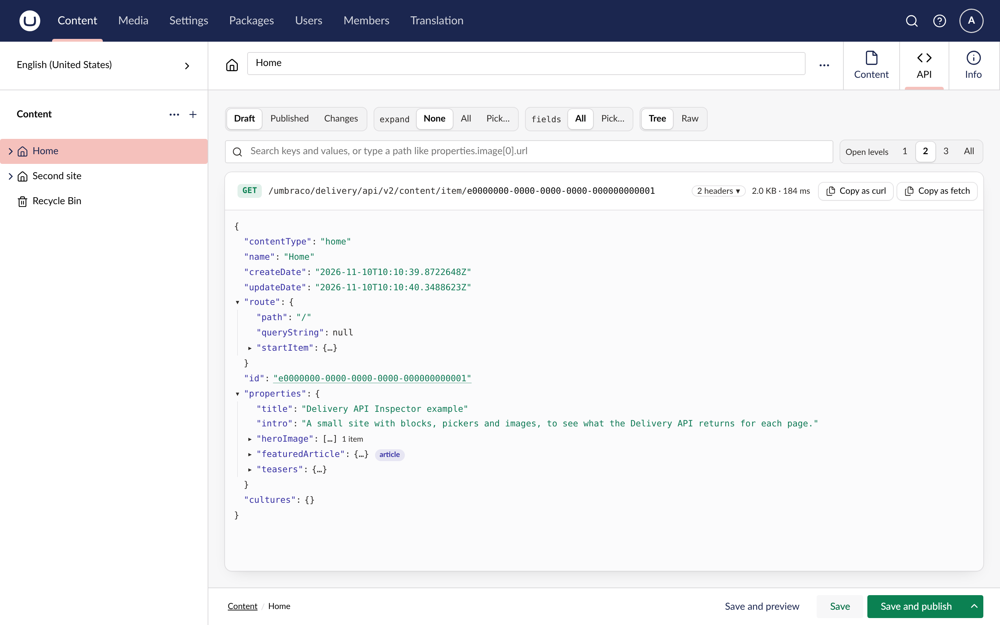

Delivery API Inspector adds an **API** tab to every document and media item in the Umbraco backoffice. It shows the JSON the Delivery API returns for that item, so a developer can see what a frontend gets without leaving the page they are editing.

The tab builds the response with the Delivery API's own builders, the code the public endpoint runs, so it shows the JSON a frontend receives.

Draft is the default view, because that is the version you are editing. Published shows what frontends get today, and Changes shows what publishing the draft would change.

The response is a tree laid out like JSON in a code editor. You can search and filter it, open it to a set depth, and set `expand` and `fields` from a menu. Collapsed blocks and pickers show their content type, with a link to the type. Media rows show a thumbnail on hover, and a GUID opens its document or media item in a new tab.

The request above the tree copies as a URL, a curl command or a `fetch` call. The whole response, or any part of it, copies as formatted JSON.

## Other tools

The inspector shows the response for one item. To explore the Delivery API's endpoints, use the OpenAPI document Umbraco 18 publishes for it, or an API client such as Bruno or Postman.

## Requirements

- Umbraco CMS 17.4 or later, including Umbraco 18, on .NET 10.
- The Delivery API added in `Program.cs` with `AddDeliveryApi()`. It does not have to be enabled for the public: the tab works on a site where `DeliveryApi:Enabled` is off, and says so.

Start with the [quickstart](/quickstart).
