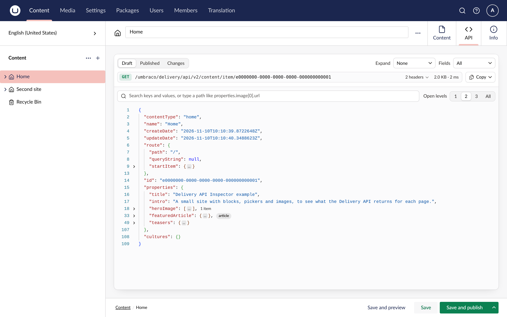

Delivery API Inspector adds an **API** tab to every document and media item in the Umbraco backoffice. It shows the JSON the Delivery API returns for that item, so a developer can see what a frontend gets without leaving the page they are editing.

## What it does

- Builds the response with the Delivery API's own builders, so it is exactly what a frontend receives.
- Shows the draft by default, with a switch to the published version and a Changes view of what publishing would change.
- Filters the tree as you search, jumps to a path such as `properties.heroImage[0].url`, and opens levels at a click.
- Sets `expand` and `fields` from pickers, without typing the syntax.
- Labels blocks and pickers with their content type, shows media thumbnails on hover, and opens a GUID's document or media item in a new tab.
- Shows the request on one line with its headers, and copies it as curl or `fetch`.
- Works when the public Delivery API is off or behind an API key. The browser never sees the key.

## Install

Needs Umbraco CMS 17.4 through 18.x on .NET 10, with `AddDeliveryApi()` in `Program.cs`.

```sh
dotnet add package TheBuilder.DeliveryApiInspector --prerelease
```

Administrators see the tab right away. To let other groups in:

```json
{
  "DeliveryApiInspector": {
    "UserGroups": ["admin", "developers"]
  }
}
```

The [documentation](https://delivery-api-inspector.thebuilder.dk/) covers every view and setting.
